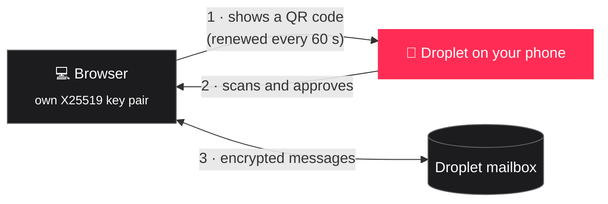

<div align="center">


# Droplet Web

**Your Droplet conversations in the browser — even with your phone switched off.**

[](https://github.com/rito27959-arch/Droplet-web/actions/workflows/verifier.yml)


[**Open Droplet Web**](https://web.dropletmesh.app) &nbsp;·&nbsp; [**Droplet**](https://dropletmesh.app) &nbsp;·&nbsp; [**The Android app**](https://github.com/rito27959-arch/droplet)

</div>

<br>

## Overview

Droplet Web brings the [Droplet](https://github.com/rito27959-arch/droplet) messenger to the desktop browser. The browser is linked once by scanning a QR code with the phone; from then on it holds **its own keys** and keeps working when the phone is off.



## Highlights

- **Linking** — a QR code renewed every 60 seconds, with an X25519 key pair unique to this browser. On a phone-sized screen, it explains how to link instead of showing a code you can't scan.
- **The full messenger** — chat list, conversations with rich text and emoji, media viewer, calls, linked devices and settings opened section by section, like iOS Settings.
- **Notifications with the tab closed** — Web Push through the mailbox, displayed by the service worker without message content.
- **Same design as the app** — `lib/design_system/` mirrors the Android app's colours, typography, motion and glass surfaces, in light and dark.
- **Ten languages**, picked from the browser.

Add `?apercu` to the address to preview the interface with sample conversations.

## Run locally

```sh
flutter pub get
flutter run -d chrome
```

## Build

```sh
flutter build web --release      # output in build/web
```

## Deployment

Every push to `main` is built and published by Vercel (`vercel-build.sh` downloads Flutter, then runs `flutter build web`) to [web.dropletmesh.app](https://web.dropletmesh.app). The *Verify* workflow analyses and builds each push and publishes the full log to the `journal-ci` branch.

<details>
<summary><strong>Repository layout</strong></summary>

<br>

| Path | Contents |
|:--|:--|
| `lib/liaison/` | Linking screen, QR invitation, linked account |
| `lib/app/` | Chat list, conversation view, composer, calls, settings |
| `lib/donnees/` | Transport, IndexedDB storage, multi-device, network calls |
| `lib/web/` | Browser integration: push notifications, single-tab guard |
| `lib/design_system/` | Shared design tokens and components |
| `web/` | `index.html`, manifest, service worker, icons |

</details>

<br>

<div align="center">
<sub>
<a href="https://dropletmesh.app">Droplet</a> &nbsp;·&nbsp;
<a href="https://dropletid.dropletmesh.app">Droplet ID</a> &nbsp;·&nbsp;
<a href="https://drop.dropletmesh.app">Droplet Drop</a> &nbsp;·&nbsp;
<a href="https://web.dropletmesh.app">Droplet Web</a>
<br><br>
Designed and built in Yaoundé, Cameroon.
</sub>
</div>
